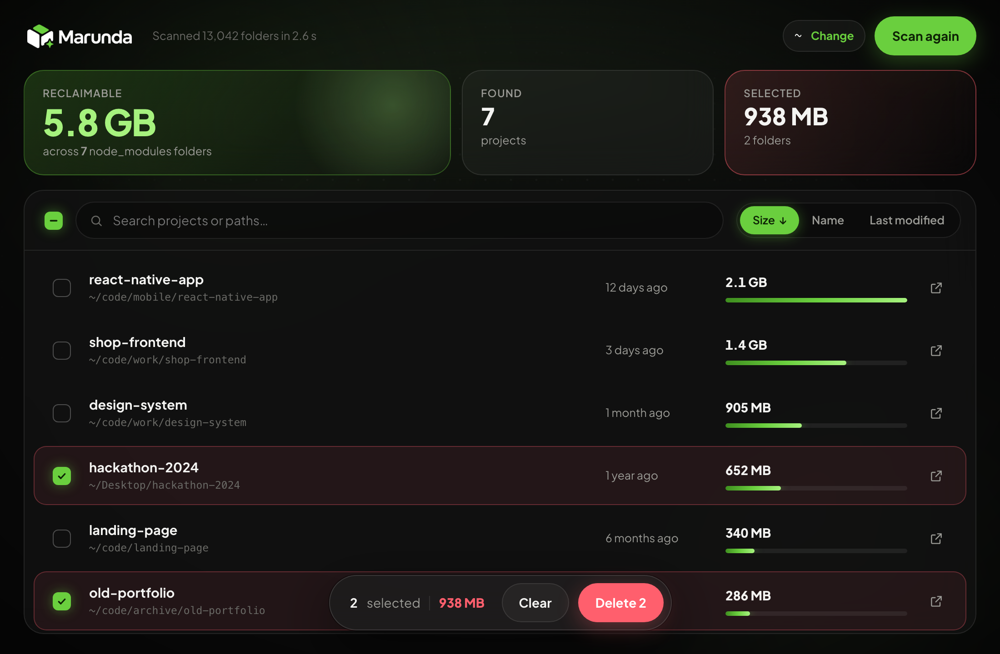
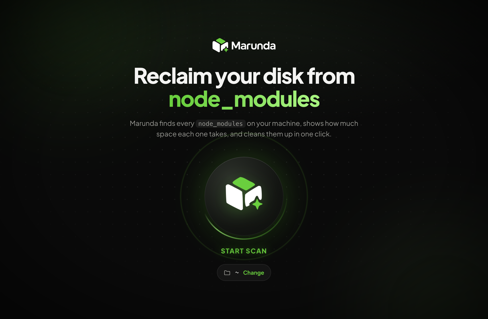
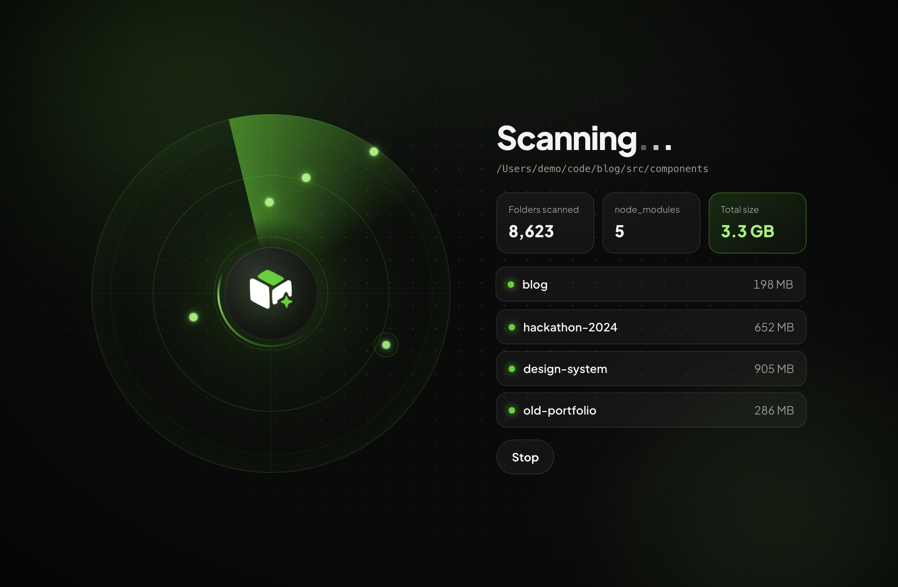

<div align="center">

<picture>
  <source media="(prefers-color-scheme: dark)" srcset="docs/assets/brand/logo-on-dark.png">
  
</picture>

<p><strong>Find every <code>node_modules</code> on your machine, see what it costs, and clean it up in one click.</strong></p>

<p>
  <a href="https://github.com/ramizbrain/marunda/releases/latest"></a>
  <a href="LICENSE"></a>
  
  
  
</p>



<table>
  <tr>
    <td></td>
    <td></td>
  </tr>
</table>

</div>

---

## Why Marunda?

Every JavaScript project you have ever cloned, tried, or abandoned leaves a `node_modules`
folder behind, often hundreds of megabytes each. They pile up quietly until your disk is full.

Marunda is a small, fast desktop app that hunts them down. It shows how much space each one
takes and lets you delete the ones you no longer need, safely.

## Features

- **Fully animated experience.** Hit the big scan button and the logo morphs into a live radar.
  Every `node_modules` it finds lights up as a blip while the counters tick up. A short
  celebration plays before the dashboard slides in.
- **Fast scan of any folder.** Results stream in while the scan runs, and you can cancel at any time.
- **Honest sizes.** Marunda reports the space actually freed on disk. Hard-linked files
  (common for `esbuild`, `workerd`, …) are counted once, so the numbers match `du`.
- **Know what's stale.** Each entry shows when its `node_modules` was last modified, a good
  hint for when you last ran `npm install`.
- **Sort and search** by size, project name, date, or path. Rows glide into their new order.
- **Bulk delete** from a floating action bar, with a confirmation dialog and a sparkle toast
  showing how much space was reclaimed.
- **Reveal in Finder / Explorer** to check a project before you delete anything.
- **Native and lightweight.** Built on Tauri and Rust, not a bundled browser.
- **Respects "Reduce motion".** If it is enabled in your OS, movement turns into simple fades.

## Safety first

Deleting folders is serious, so the guard rails live in the Rust backend, not just the UI:

- Only folders **named exactly `node_modules`** can be deleted. Any other path is refused,
  even if the frontend asks.
- **Symlinks are never deleted** and never followed while scanning.
- Each folder is deleted independently, so one failure never stops the rest. Failures are
  reported with the reason.
- The scanner skips hidden folders (`.git`, `.nvm`, `.cache`, …) and OS folders such as
  `Library` and `AppData`. A `node_modules` nested inside another one is never listed separately.

> [!WARNING]
> Deletion is permanent (it does not go to the Trash). You can always restore a project's
> dependencies with `npm install` / `pnpm install` / `yarn`.

## Installation

### Download

Grab the latest version from the **[Releases page](https://github.com/ramizbrain/marunda/releases/latest)**:

| OS | File |
| --- | --- |
| macOS (Apple Silicon and Intel) | `Marunda_x.y.z_universal.dmg` |
| Windows 10/11 | `Marunda_x.y.z_x64-setup.exe` (or the `.msi`) |
| Linux | `Marunda_x.y.z_amd64.AppImage`, `.deb`, or `.rpm` |

What changed in each version is listed in [CHANGELOG.md](CHANGELOG.md).

#### Opening Marunda for the first time

Marunda's builds are not signed with a paid Apple or Microsoft certificate yet, so your OS
will warn you the first time:

- **macOS:** drag Marunda to Applications and open it. When macOS says it can't verify the
  app, open **System Settings → Privacy & Security**, scroll down, and click **Open Anyway**.
  If macOS instead says the app "is damaged", run
  `xattr -cr /Applications/Marunda.app` in Terminal and open it again.
- **Windows:** if SmartScreen shows "Windows protected your PC", click **More info → Run anyway**.

### Build from source

#### Prerequisites

- [Node.js](https://nodejs.org) 20+ and [pnpm](https://pnpm.io)
- [Rust](https://www.rust-lang.org/tools/install) 1.85+
- The [Tauri system prerequisites](https://tauri.app/start/prerequisites/) for your OS

#### Build

```bash
git clone https://github.com/ramizbrain/marunda.git
cd marunda
pnpm install
pnpm tauri build
```

The installer / app bundle is written to `src-tauri/target/release/bundle/`.

## Development

```bash
pnpm install
pnpm tauri dev      # run the app with hot reload
```

| Command | What it does |
| --- | --- |
| `pnpm test` | Frontend unit and component tests (Vitest + Testing Library) |
| `pnpm lint` | ESLint, including the React Hooks rules |
| `pnpm typecheck` | TypeScript in strict mode |
| `pnpm test:rust` | Backend tests: domain logic, JSON contract, and Tauri IPC (mock runtime) |
| `cargo clippy --manifest-path src-tauri/Cargo.toml --all-targets -- -D warnings` | Rust lints |

There is also a read-only smoke test that scans a real folder and prints what it finds:

```bash
MARUNDA_SCAN_ROOT=~/code cargo test --manifest-path src-tauri/Cargo.toml real_folder -- --ignored --nocapture
```

## Architecture

```
src-tauri/src/            Rust backend
  lib.rs                  wires the Tauri app: plugins, state, commands
  commands.rs             thin IPC layer: validates input, moves blocking work off the async runtime
  scanner.rs              walks the file system and finds node_modules (no Tauri dependency)
  disk_usage.rs           measures a folder's size on disk (hard-link aware)
  cleaner.rs              deletes node_modules behind safety checks
  scan_registry.rs        cancellation flag for the running scan
  models.rs               data sent to the frontend, plus JSON contract tests
  error.rs                one error type for the whole backend

src/                      React frontend
  App.tsx                 orchestrates the three phases: welcome → scanning → dashboard
  services/marundaApi.ts  the only module that talks to Tauri
  hooks/                  state: scan reducer, selection, deletion, scan root
  lib/                    pure functions: formatting, sorting, phase transitions, radar positions
  components/
    welcome/              hero screen and the scan orb
    scanning/             radar, live counters, and feed of finds
    dashboard/            stats, list, selection bar, dialog, toast
    motion/               shared animation pieces (animated numbers, sparkles, backdrop)
    brand/                logo and sparkle marks
  styles/                 design tokens and per-screen styles
  types/                  TypeScript mirrors of the Rust models
```

The project follows a few principles:

- **Domain logic is independent of the framework.** `scanner`, `disk_usage`, and `cleaner`
  know nothing about Tauri and are tested against real temporary folders. On the frontend,
  logic lives in pure functions and a reducer, not in components.
- **One door to the backend.** Components never call `invoke` directly. Everything goes
  through `services/marundaApi.ts`.
- **Motion is presentation, not logic.** Animations use [Motion](https://motion.dev). Timing
  lives in `lib/timing.ts`, and screen changes are decided by the pure `phaseAfterScan`.
  Tests switch animations off and check behaviour.
- **Explicit contracts.** Scan progress is a tagged union (`found` / `progress` / `finished`)
  streamed over a Tauri channel and mirrored one-to-one in `types/nodeModules.ts`. Tests on
  both sides pin its shape.

## Contributing

Contributions are welcome. Please read [CONTRIBUTING.md](CONTRIBUTING.md) before opening a pull request.

## License

[MIT](LICENSE) © Marunda contributors
